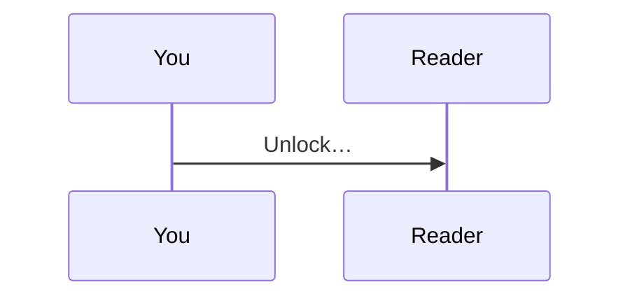
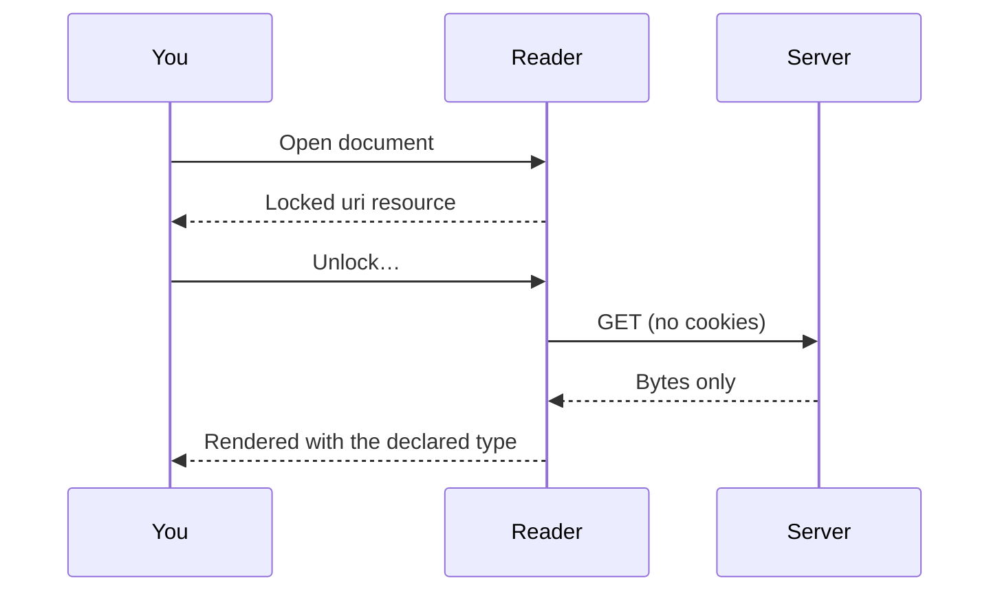
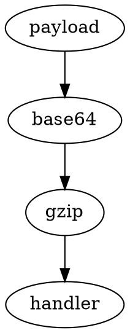
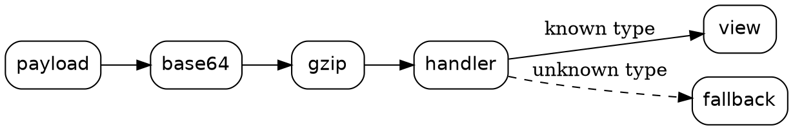
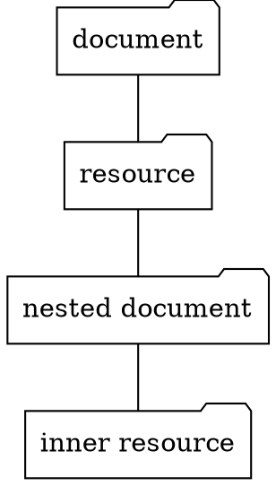

# Developer features

A handful of handlers make Markdown2 at home in technical writing:

- code blocks that know their language
- Mermaid diagrams
- Graphviz graphs
- WaveDrom timing diagrams and register maps
- mathematics
- interactive 3D scenes

None of them is new syntax. Each is a handler for a declared type, or a compatibility alias for a fenced code block. A reader without them still shows every character of the source.

| Feature  | Fence names          | Resource type                                         | Drawn by                 |
| :------- | :------------------- | :---------------------------------------------------- | :----------------------- |
| Code     | `ts`, `python`, …    | `text/javascript`, `text/css`, …                      | Monaco, sandboxed frame  |
| Mermaid  | `mermaid`            | `text/vnd.mermaid`                                    | Mermaid, sandboxed frame |
| Graphviz | `dot`, `graphviz`    | `text/vnd.graphviz`                                   | Graphviz (WebAssembly)   |
| WaveDrom | `wavedrom`           | `text/vnd.wavedrom`                                   | WaveDrom, as an image    |
| Maths    | `math`               | `application/x-tex`, `application/mathml+xml`         | MathJax, as an image     |
| 3D       | `x3d`                | `model/x3d+xml`, `model/x3d-vrml`, `model/vrml`       | X_ITE, sandboxed frame   |

## Code that knows its language

A fenced code block with a language name is shown in a read-only Monaco editor, with syntax highlighting, line numbers and folding:

```typescript
interface Resource {
  type: string | undefined;
  encoding: readonly string[];
  payload: Uint8Array;
}

export function isText(r: Resource): boolean {
  return r.type?.startsWith('text/') ?? false;
}
```

```python
def decode(stack, payload):
    """Apply decoders left to right, as the encoding attribute lists them."""
    for decoder in stack:
        payload = decoder(payload)
    return payload
```

```rust
fn closes(line: &str, token: &str) -> bool {
    line.trim_end_matches([' ', '\t']) == token
}
```

```bash
gzip -c topology.svg | base64 -w 76 > payload.txt
```

The editor runs in a sandboxed frame with an opaque origin. Until it has loaded, and whenever it cannot load (offline, for example), you see the plain code instead. The styling tree does not change either way: the block is still `pre > code.language-typescript`, so document styles keep working.

Supported names include `js`, `ts`, `python`, `bash`, `rust`, `go`, `java`, `kotlin`, `csharp`, `cpp`, `swift`, `ruby`, `php`, `sql`, `yaml`, `html`, `xml`, `css`, `dockerfile` and more. Other names stay ordinary code blocks.

Code can also be embedded as a resource, opaque like any other, when its declared type is a code type such as `text/javascript`:

<<<SNIPPET type="text/javascript" title="snippet.js"
// Nothing here is Markdown: # not a heading, ``` not a fence.
export const greet = (name) => `Hello, ${name}!`;
SNIPPET

## Diagrams with Mermaid

A fenced block named `mermaid` is drawn as a diagram:

````text

````



The same diagram language works as a resource of type `text/vnd.mermaid`, which can carry a title and travel inside nested or encrypted documents:

<<<FLOW type="text/vnd.mermaid" title="The decode pipeline"
flowchart LR
  P[payload] --> B[base64]
  B --> G[gzip]
  G --> H{handler for the type?}
  H -- yes --> V[view]
  H -- no --> F[fallback stub]
FLOW

Mermaid runs in a sandboxed frame with its strict security level. A diagram that does not parse keeps showing its source, with the error underneath. `text/vnd.mermaid` is not yet registered with IANA. Markdown2 lists it as a provisional name.

## Graphs with Graphviz

A fenced block named `dot` holds a graph in the DOT language:

````text

````



`graphviz` works as a fence name too. Undirected graphs use `graph` and `--`:



As a resource, a graph is `text/vnd.graphviz`. The `layout` attribute picks the engine: `dot` (the default), `neato`, `fdp`, `sfdp`, `circo`, `twopi`, `osage` or `patchwork`. Any other value falls back to `dot`. This network is laid out by `neato`:

<<<NETWORK type="text/vnd.graphviz" layout="neato" title="A small network"
graph network {
  node [shape=circle, style=filled, fillcolor="#d8ece7"];
  edge [color="#b0802a"];
  hub [shape=doublecircle, fillcolor="#f3e4c3"];
  hub -- a; hub -- b; hub -- c; hub -- d;
  a -- b; c -- d;
}
NETWORK

The source of that resource:

```text
<<<NETWORK type="text/vnd.graphviz" layout="neato" title="A small network"
graph network {
  hub -- a; hub -- b; hub -- c; hub -- d;
  a -- b; c -- d;
}
NETWORK
```

- Graphviz is compiled to WebAssembly and runs in a sandboxed frame with an opaque origin. Nothing is fetched from the web.
- The SVG it produces is shown through an image, so `URL` and `href` attributes in a graph stay inert.
- A graph that does not parse keeps showing its source, with the error underneath.

## Timing diagrams with WaveDrom

WaveDrom draws digital timing diagrams from WaveJSON. A fenced block named `wavedrom` holds one:

```wavedrom
{ signal: [
  { name: "clk",  wave: "p......." },
  { name: "req",  wave: "0.1..0.." },
  { name: "ack",  wave: "0..1..0." },
  { name: "data", wave: "x.345x..", data: ["A", "B", "C"] }
],
  head: { text: "A request and its acknowledgement" }
}
```

Each character of `wave` is one clock period: `p` a clock, `0` and `1` levels, `x` undefined, `.` "same as before", and `2` to `9` data slots, labelled in order from `data`.

WaveDrom also draws register maps. As a resource, a diagram is `text/vnd.wavedrom`:

<<<CTRL type="text/vnd.wavedrom" title="CTRL register"
{ reg: [
  { bits: 1, name: "EN",   attr: "RW" },
  { bits: 3, name: "MODE", attr: "RW" },
  { bits: 4 },
  { bits: 8, name: "DIV",  attr: "RW" }
],
  config: { hspace: 640, bits: 16 }
}
CTRL

- The source is read as relaxed JSON (JSON5): unquoted keys, single quotes and trailing commas are fine. WaveDrom's own loader would evaluate it as JavaScript. Markdown2 never does, so an expression such as `(function(){ … })()` is a handler error, not code that runs.
- The diagram is turned into SVG in this tab and shown through an image, like maths.
- An invalid diagram shows the resource's fallback with `handler-error`. An invalid fence stays an ordinary code block.

`text/vnd.graphviz` and `text/vnd.wavedrom` are provisional names, like `text/vnd.mermaid`.

## Mathematics with MathJax

A fenced block named `math` holds TeX:

```math
\int_{-\infty}^{\infty} e^{-x^2}\,dx = \sqrt{\pi}
```

As a resource, TeX is `application/x-tex`:

<<<MAXWELL type="application/x-tex" title="Two of Maxwell's equations"
\begin{aligned}
\nabla \cdot \mathbf{E} &= \frac{\rho}{\varepsilon_0} \\
\nabla \times \mathbf{B} &= \mu_0 \mathbf{J} + \mu_0 \varepsilon_0 \frac{\partial \mathbf{E}}{\partial t}
\end{aligned}
MAXWELL

MathML works too, as `application/mathml+xml`:

<<<QUADRATIC type="application/mathml+xml" title="The quadratic formula"
<math xmlns="http://www.w3.org/1998/Math/MathML" display="block"><mi>x</mi><mo>=</mo><mfrac><mrow><mo>−</mo><mi>b</mi><mo>±</mo><msqrt><msup><mi>b</mi><mn>2</mn></msup><mo>−</mo><mn>4</mn><mi>a</mi><mi>c</mi></msqrt></mrow><mrow><mn>2</mn><mi>a</mi></mrow></mfrac></math>
QUADRATIC

MathJax turns each formula into an SVG image in this tab, using only its `base` and `ams` TeX packages. The image cannot run anything, and its alternative text is the source.

Maths is block-level only. Markdown2 adds no syntax, so there is no inline `$…$`.

## 3D scenes with X3D

X3D is the ISO standard for 3D content on the web. A resource of type `model/x3d+xml` is drawn by X_ITE as an interactive scene. Drag to turn it, scroll to zoom:

<<<SCENE type="model/x3d+xml" title="A box and a sphere"
<X3D profile='Interchange' version='4.0'>
   <Scene>
     <Background skyColor='0.96 0.93 0.85'/>
     <Viewpoint position='0 0 8' description='Front'/>
     <Transform translation='-1.5 0 0' rotation='1 1 0 0.6'>
       <Shape>
         <Appearance><Material diffuseColor='0.06 0.42 0.37'/></Appearance>
         <Box size='2 2 2'/>
       </Shape>
     </Transform>
     <Transform translation='1.5 0 0'>
       <Shape>
         <Appearance><Material diffuseColor='0.69 0.5 0.16'/></Appearance>
         <Sphere radius='1.2'/>
       </Shape>
     </Transform>
   </Scene>
</X3D>
SCENE

The classic VRML encoding works as `model/x3d-vrml`, and VRML97 as `model/vrml`. A fenced block named `x3d` holds the XML encoding:

```x3d
<X3D profile='Interchange' version='4.0'>
   <Scene>
     <Shape>
       <Appearance><Material diffuseColor='0.7 0.2 0.1'/></Appearance>
       <Cone height='2' bottomRadius='1'/>
     </Shape>
   </Scene>
</X3D>
```

- The scene runs in a sandboxed frame with an opaque origin. It cannot reach this app, its storage, your keys or the toolbar.
- Nothing is fetched from the web. Textures, `Inline` worlds and other external files only work as `data:` URLs.
- Until the scene has drawn, and whenever it cannot be drawn, you see its source.

## Safety, in one list

- **Sandboxed.** Monaco, Mermaid, Graphviz and X3D scenes run in frames with an opaque origin. They cannot reach this app, its storage, your keys or the toolbar.
- **Source on request.** A frame receives only its own source, and only once.
- **Never evaluated.** WaveJSON is parsed as data, never run as script.
- **Inert images.** Maths, WaveDrom and Graphviz output is an image, never live markup.
- **Graceful.** Offline, blocked or broken, every block falls back to its source text.

## Next

- [Back to the welcome page](index.md)
- Tour stop 7: [Web pages and charts](embeds.md), embedded pages and Google Charts, loaded only when you allow them.