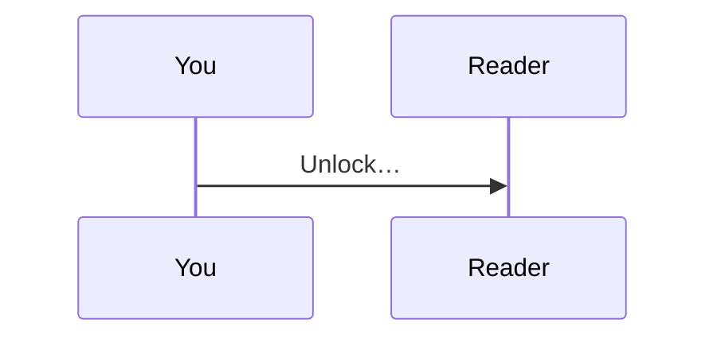
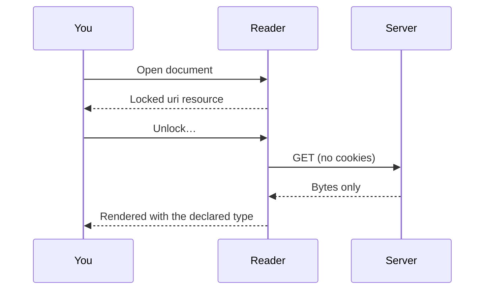

# Developer features

Three handlers make Markdown2 at home in technical writing:

- code blocks that know their language
- Mermaid diagrams
- mathematics

None of them is new syntax. Each is a handler for a declared type, or a compatibility alias for a fenced code block. A reader without them still shows every character of the source.

## Code that knows its language

A fenced code block with a language name is shown in a read-only Monaco editor, with syntax highlighting, line numbers and folding:

```typescript
interface Resource {
  type: string | undefined;
  encoding: readonly string[];
  payload: Uint8Array;
}

export function isText(r: Resource): boolean {
  return r.type?.startsWith('text/') ?? false;
}
```

```python
def decode(stack, payload):
    """Apply decoders left to right, as the encoding attribute lists them."""
    for decoder in stack:
        payload = decoder(payload)
    return payload
```

```rust
fn closes(line: &str, token: &str) -> bool {
    line.trim_end_matches([' ', '\t']) == token
}
```

```bash
gzip -c topology.svg | base64 -w 76 > payload.txt
```

The editor runs in a sandboxed frame with an opaque origin. Until it has loaded, and whenever it cannot load (offline, for example), you see the plain code instead. The styling tree does not change either way: the block is still `pre > code.language-typescript`, so document styles keep working.

Supported names include `js`, `ts`, `python`, `bash`, `rust`, `go`, `java`, `kotlin`, `csharp`, `cpp`, `swift`, `ruby`, `php`, `sql`, `yaml`, `html`, `xml`, `css`, `dockerfile` and more. Other names stay ordinary code blocks.

Code can also be embedded as a resource, opaque like any other, when its declared type is a code type such as `text/javascript`:

<<<SNIPPET type="text/javascript" title="snippet.js"
// Nothing here is Markdown: # not a heading, ``` not a fence.
export const greet = (name) => `Hello, ${name}!`;
SNIPPET

## Diagrams with Mermaid

A fenced block named `mermaid` is drawn as a diagram:

````text

````



The same diagram language works as a resource of type `text/vnd.mermaid`, which can carry a title and travel inside nested or encrypted documents:

<<<FLOW type="text/vnd.mermaid" title="The decode pipeline"
flowchart LR
  P[payload] --> B[base64]
  B --> G[gzip]
  G --> H{handler for the type?}
  H -- yes --> V[view]
  H -- no --> F[fallback stub]
FLOW

Mermaid runs in a sandboxed frame with its strict security level. A diagram that does not parse keeps showing its source, with the error underneath. `text/vnd.mermaid` is not yet registered with IANA. Markdown2 lists it as a provisional name.

## Mathematics with MathJax

A fenced block named `math` holds TeX:

```math
\int_{-\infty}^{\infty} e^{-x^2}\,dx = \sqrt{\pi}
```

As a resource, TeX is `application/x-tex`:

<<<MAXWELL type="application/x-tex" title="Two of Maxwell's equations"
\begin{aligned}
\nabla \cdot \mathbf{E} &= \frac{\rho}{\varepsilon_0} \\
\nabla \times \mathbf{B} &= \mu_0 \mathbf{J} + \mu_0 \varepsilon_0 \frac{\partial \mathbf{E}}{\partial t}
\end{aligned}
MAXWELL

MathML works too, as `application/mathml+xml`:

<<<QUADRATIC type="application/mathml+xml" title="The quadratic formula"
<math xmlns="http://www.w3.org/1998/Math/MathML" display="block"><mi>x</mi><mo>=</mo><mfrac><mrow><mo>−</mo><mi>b</mi><mo>±</mo><msqrt><msup><mi>b</mi><mn>2</mn></msup><mo>−</mo><mn>4</mn><mi>a</mi><mi>c</mi></msqrt></mrow><mrow><mn>2</mn><mi>a</mi></mrow></mfrac></math>
QUADRATIC

MathJax turns each formula into an SVG image in this tab, using only its `base` and `ams` TeX packages. The image cannot run anything, and its alternative text is the source.

Maths is block-level only. Markdown2 adds no syntax, so there is no inline `$…$`.

## Safety, in one list

- **Sandboxed.** Monaco and Mermaid run in frames with an opaque origin. They cannot reach this app, its storage, your keys or the toolbar.
- **Source on request.** A frame receives only its own source, and only once.
- **Inert images.** Maths is an image, never live markup.
- **Graceful.** Offline, blocked or broken, every block falls back to its source text.

## Next

- [Document styles](styles.md)
- [Back to the welcome page](index.md)