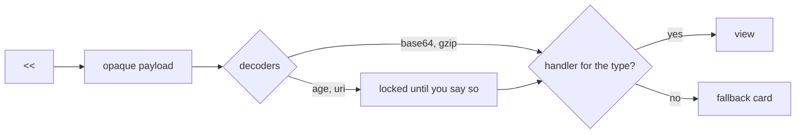

<!--
<<<TOURBASE type="text/css" rel="stylesheet"
md2-resource.hero {
  border: 2px solid #0f6b5f;
  border-radius: 14px;
  background: linear-gradient(135deg, rgba(15, 107, 95, 0.08), rgba(176, 128, 42, 0.12));
}
md2-resource.hero md2-document h2 { margin-top: 0; color: #0f6b5f; }
md2-resource.aside { border-left: 4px solid #b0802a; font-size: 0.95em; }
md2-resource.aside md2-document p:last-child { margin-bottom: 0; }
TOURBASE
-->

<!--
<<<TOURPAPER type="text/css" rel="stylesheet" md2-group="Page tint" title="Paper" md2-default="on"
/* The reader's own page colours. */
TOURPAPER
-->

<!--
<<<TOURSEPIA type="text/css" rel="stylesheet" md2-group="Page tint" title="Sepia"
:root { background: #f4ecd8; color: #3b2f1e; }
TOURSEPIA
-->

<!--
<<<TOURNIGHT type="text/css" rel="stylesheet" md2-group="Page tint" title="Night"
:root { background: #1d1b22; color: #e6dfd2; }
md2-resource { background: #26232d; border-color: #3a3644; }
md2-resource.hero md2-document h2 { color: #7fd1c3; }
TOURNIGHT
-->

<!--
<<<TOURCOMPACT type="text/css" rel="stylesheet" md2-group="Compact tour" title="Compact tour" md2-default="off"
md2-resource.aside { display: none; }
TOURCOMPACT
-->

# Welcome to Markdown2

**Markdown, plus one idea.** You can embed *opaque, typed resources*: pictures, data, diagrams, code, maths, charts, even whole other documents. Resources can nest inside each other. Everything else on this page follows from that one idea.

<<<HERO type="text/markdown" md2-class="hero" title="Start here"
## This page is the tour

Everything below is live. It is a Markdown2 document, rendered by the reader you are using right now.

- Press **Ctrl+2** (⌘2 on a Mac) to see the source beside the page.
- Edit anything you like. Your changes stay in this tab.
- Press **?** at any time for the keyboard sheet.

This card is a nested document, and the gold-and-green frame around it comes from a stylesheet in this page's source. Press **Ctrl+Shift+U** and the frame disappears. The words stay.
HERO

## The tour in sixty seconds

Try these in order. Each takes a few seconds:

1. **See the source.** Press **Ctrl+2**. The page updates as you type on the left.
2. **Open the inspector.** Press **Ctrl+.**. It lists every resource on this page with its true state.
3. **Change the look.** In the inspector's **Styles** tab, pick *Night* under *Page tint*. Then open [document styles](styles.md): it opens in Night too, because both pages offer the same choice.
4. **Meet a lock.** In the **Resources** tab, find the card marked *locked* and choose *Unlock…*. You decide whether this page may contact a server.
5. **Break something.** In the source, delete the `type="…"` attribute from any resource. It turns into a failed card, and a diagnostic appears with a red dot in the gutter. Nothing leaks into the page. Press **Ctrl+Z** to undo.
6. **Strip it bare.** Press **Ctrl+Shift+U** for the unstyled view, and again to come back.

## One primitive

A resource starts with `<<<`, a terminator token you choose, and some attributes. It ends at the first line that holds just that token:

```text
<<<NOTE type="text/plain" title="A note"
Anything at all stays opaque here.
# This is not a heading, and ``` is not a fence.
NOTE
```

Here is that exact block, live:

<<<NOTE type="text/plain" title="A note"
Anything at all stays opaque here.
# This is not a heading, and ``` is not a fence.
NOTE

Four rules cover almost everything:

- **You choose the terminator.** If your payload contains the word `NOTE` on a line of its own, call the block `NOTE2` instead. Nothing ever needs escaping.
- **The type is declared, never guessed.** The reader hands the bytes to the handler for the declared `type`, and only that one.
- **Unknown is not invisible.** A type the reader cannot show still appears as a card with its title, type and size.
- **Older readers still cope.** In an ordinary Markdown preview, a resource is just a few lines of text. Nothing is lost.

<<<ASIDE1 type="text/markdown" md2-class="aside" title="Behind the scenes"
The *Compact tour* switch in the Styles tab hides every card like this one. Each is a nested document with `md2-class="aside"`, and one line of this page's CSS can hide them all. That is how a stretch of Markdown gets a class.
ASIDE1

## The showcase

Every block in this section uses the same primitive. Only the declared type changes.

### Pictures

SVG is drawn through an image, where scripts can never run. The `describedby` resource right after it becomes the image's alternative text:

<<<DOLLS type="image/svg+xml" title="Documents all the way down"
<svg xmlns="http://www.w3.org/2000/svg" width="320" height="140" viewBox="0 0 320 140"><rect x="4" y="4" width="312" height="132" rx="16" fill="#f4ecd8" stroke="#b0802a" stroke-width="3"/><text x="16" y="20" font-family="sans-serif" font-size="11" fill="#b0802a">document</text><rect x="40" y="26" width="240" height="88" rx="12" fill="#ffffff" stroke="#0f6b5f" stroke-width="3"/><text x="50" y="41" font-family="sans-serif" font-size="11" fill="#0f6b5f">resource</text><rect x="88" y="50" width="144" height="48" rx="10" fill="#0f6b5f"/><text x="160" y="80" font-family="sans-serif" font-size="18" font-weight="700" fill="#ffffff" text-anchor="middle">&lt;&lt;&lt;M2</text></svg>
DOLLS
<<<DOLLSDESC type="text/plain" rel="describedby"
Three nested rounded boxes: a document holding a resource, which holds another Markdown2 document.
DOLLSDESC

### Data

JSON is pretty-printed. YAML is shown as text and never instantiated, so even a hostile tag is just characters:

<<<DATA type="application/json" title="A little JSON"
{"format": "Markdown2", "draft": 0.2, "ideas": 1, "resources": ["typed", "opaque", "nested"]}
DATA

<<<CONF type="application/yaml" title="Harmless YAML"
name: tour
stops: [guide, markdown, resources, trust, styles, developer, embeds]
danger: !!python/object:os.system rm -rf /
CONF

### Code that knows its language

A fenced block with a language name opens in a read-only, sandboxed Monaco editor, with highlighting, line numbers and folding:

```typescript
type State = 'decoded' | 'locked' | 'unsupported' | 'failed';

export function describe(state: State): string {
  switch (state) {
    case 'decoded': return 'Shown by its handler';
    case 'locked': return 'Waiting for you';
    case 'unsupported': return 'Kept, with a fallback card';
    case 'failed': return 'Failed closed, with a diagnostic';
  }
}
```

### Diagrams

A fenced `mermaid` block becomes a diagram. This one is the life of every resource on this page:



### Mathematics

TeX in a `math` block, rendered by MathJax as an inert image:

```math
e^{i\pi} + 1 = 0
\qquad
\sum_{n=1}^{\infty} \frac{1}{n^2} = \frac{\pi^2}{6}
```

MathML works too, declared as `application/mathml+xml`:

<<<EULER type="application/mathml+xml" title="Euler's identity, in MathML"
<math xmlns="http://www.w3.org/1998/Math/MathML" display="block"><msup><mi>e</mi><mrow><mi>i</mi><mi>π</mi></mrow></msup><mo>+</mo><mn>1</mn><mo>=</mo><mn>0</mn></math>
EULER

### Charts that wait for you

A chart reaches the network for Google's library, so it waits for permission. Until you choose *Load…* in the Resources tab, you see its data as a table:

<<<HANDLERS type="application/vnd.google.charts+json" title="What this reader can show"
{
  "chartType": "ColumnChart",
  "data": [
    ["Family", "Handlers"],
    ["Text and Markdown", 3],
    ["Images", 2],
    ["Data", 2],
    ["Code", 2],
    ["Diagrams", 1],
    ["Maths", 2],
    ["Web", 2]
  ],
  "options": { "title": "Handlers by family", "legend": { "position": "none" }, "colors": ["#0f6b5f"], "height": 300 }
}
HANDLERS

### Bytes in disguise

An `encoding` says how to recover the bytes. This payload is `base64`, decoded in your browser:

<<<HELLO type="text/plain" encoding="base64" title="Decoded from base64"
SGVsbG8sIHdvcmxkIQ==
HELLO

Stacks such as `encoding="base64 gzip"` carry compressed binaries as plain text. Compression is an encoding, not a type: a gzipped SVG is still an SVG.

### Attachments

`rel="attachment"` means "save me" rather than "show me". Find it in the Resources tab and choose *Save*:

<<<CARD type="text/plain" rel="attachment" filename="tour-card.txt" title="A souvenir"
You took the Markdown2 tour.
One primitive. Typed, opaque, nestable.
CARD

### Alternates and the unknown

A reader shows at most one of a resource and its `rel="alternate"`. This reader cannot draw the first one, so it shows the second:

<<<HOLO type="image/x-hologram" title="A format from the future"
opaque hologram data
HOLO
<<<HOLOTEXT type="text/plain" rel="alternate" title="Plain-text alternative"
A small spinning cube, glowing green and gold.
HOLOTEXT

With no alternate, an unknown type still keeps its place, its title and its size. It is never silently dropped:

<<<CAD type="model/x-acme-cad" title="Bracket drawing" filename="bracket.cad"
opaque bytes that only a CAD handler would understand
CAD

## Documents inside documents

A `text/markdown` resource is rendered by Markdown2 itself, so documents nest. Each level has its own Markdown, its own resources and even its own styles:

<<<OUTER type="text/markdown" title="Level one"
### Level one

An ordinary nested document, with *emphasis* and a list:

- it can carry resources
- it can carry documents

<<<MIDDLE type="text/markdown" title="Level two, with its own style"
<<<MIDDLESTYLE type="text/css" rel="stylesheet"
p { font-style: italic; color: #0f6b5f; }
MIDDLESTYLE
This level carries a stylesheet. It turns these paragraphs green and italic, and it cannot touch anything outside this card.

<<<CORE type="text/plain" title="Level three"
Hello from the core. Three documents deep, and still just bytes.
CORE
MIDDLE
OUTER

Each resource ends at its own terminator, so `OUTER` never mistakes the line `MIDDLE` for its end. Because styles stay inside their document, a nested or third-party section cannot restyle the page around it, for example to hide a warning.

<<<ASIDE2 type="text/markdown" md2-class="aside" title="Behind the scenes"
Encrypt a nested document and one key hides a whole structure: its text, its resources, even the true types of what is inside. The [locks and keys](trust.md) page shows how.
ASIDE2

## Nothing happens behind your back

This resource lives on the web, so it is **locked**:

<<<REMOTE type="image/svg+xml" encoding="uri" title="The Markdown2 icon, fetched on request"
https://md2.cognotik.com/icon.svg
REMOTE

Open the **Resources** tab and choose *Unlock…*. You see exactly which address will be contacted, and only this one resource is allowed. Whatever the server sends back, it is treated as the declared type, an SVG image, and nothing else.

Encrypted resources work the same way, with an `age` passphrase or identity instead of a server. Keys live in this tab's memory only, and **Forget keys** in the toolbar drops them all at once.

## Styles this page offers

Open the **Styles** tab. This page offers two things:

- **Page tint** is a *choice*: *Paper*, *Sepia* or *Night*. Exactly one applies. Your pick is remembered by group name and title, so every document that offers *Page tint* opens the same way.
- **Compact tour** is a *switch*. Turn it on to hide the "Behind the scenes" cards.

You always win. **Unstyled** removes every document style at once, and *My styles…* lets your own CSS override any document.

## What a document can never do

However it is written, a document opened here cannot:

- **Run script in this app.** SVG is drawn as an image, maths is an image, and Monaco, Mermaid, charts and embedded pages run in sandboxed frames with an opaque origin.
- **Reach the network on its own.** Remote resources, charts and embedded pages all wait for you. Even images named in prose are shown as links rather than fetched.
- **Fetch through its styles.** `@import` is ignored and remote `url()` references are removed.
- **Fake the chrome.** The toolbar, the inspector and every dialog sit outside the page, where no style can reach.
- **Hide a lock.** A locked or failed resource always shows its card.
- **Name a dangerous file.** Saving a resource with an active extension, such as `.html`, needs your confirmation.

## Cheat sheet

| Attribute    | Example                     | What it does                                    |
| :----------- | :-------------------------- | :---------------------------------------------- |
| `type`       | `"image/svg+xml"`           | **Required.** What the bytes are                |
| `encoding`   | `"base64 gzip"`             | Decoders, applied left to right                 |
| `rel`        | `"attachment"`              | What the resource is to its document            |
| `title`      | `"Q3 notes"`                | A human name, shown even when locked            |
| `filename`   | `"notes.txt"`               | A suggested name for saving, never trusted      |
| `md2-class`  | `"callout"`                 | A class for document styles to target           |
| `md2-group`  | `"Page tint"`               | Groups stylesheets into a choice or a switch    |
| `md2-default`| `"off"`                     | Whether a stylesheet starts on or off           |

Fenced blocks named `mermaid` and `math`, and fences with a language name, need no attributes at all.

## Opening any document by URL

Add `?url=` to the address of this app:

```text
/?url=/docs/resources.md
/?url=https://example.org/notes/today.md
```

Paths on this site open straight away. Documents on other `https:` sites ask first, and no cookies are sent. Opening a document never unlocks or fetches anything inside it. Pages opened this way, like this one, are never autosaved over your own draft.

## The rest of the tour

Each page ends with a link to the next, and the last one brings you back here.

| Stop | Page                                           | What you will learn                                    |
| :--: | :--------------------------------------------- | :----------------------------------------------------- |
| 1    | [Using the app](guide.md)                      | Layouts, the inspector, drafts, saving, shortcuts      |
| 2    | [Markdown formatting](markdown.md)             | Every Markdown feature the reader renders              |
| 3    | [Resources and encodings](resources.md)        | Types, `base64`, `gzip`, relationships, placement      |
| 4    | [Locks, keys and remote resources](trust.md)   | Encryption, remote fetches, and why you hold the keys  |
| 5    | [Document styles](styles.md)                   | Themes and switches, and how you stay in charge        |
| 6    | [Developer features](developer.md)             | Monaco code, Mermaid diagrams, MathJax                 |
| 7    | [Web pages and charts](embeds.md)              | Embedded pages and Google Charts, on your say-so       |

Ready? [Start with using the app →](guide.md)